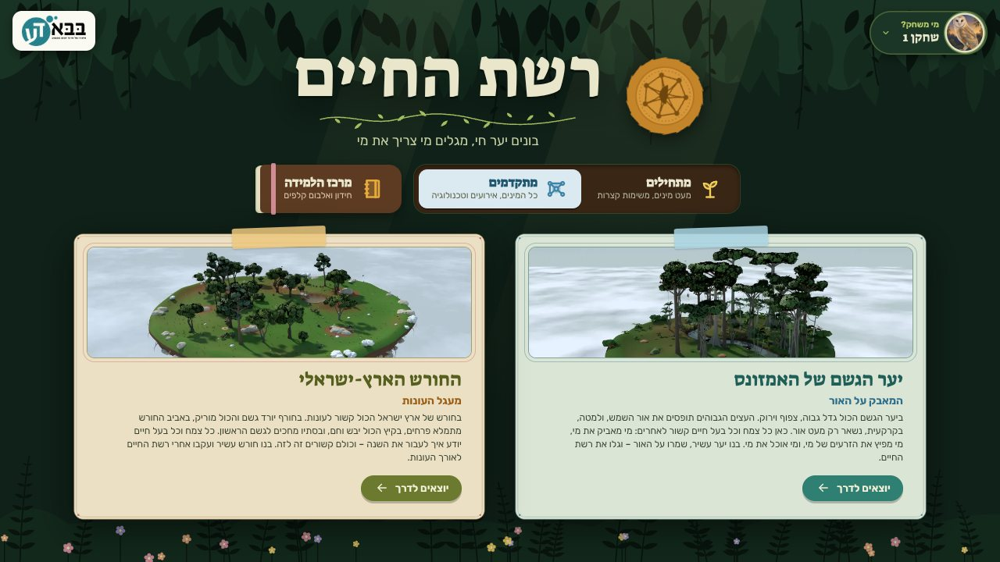
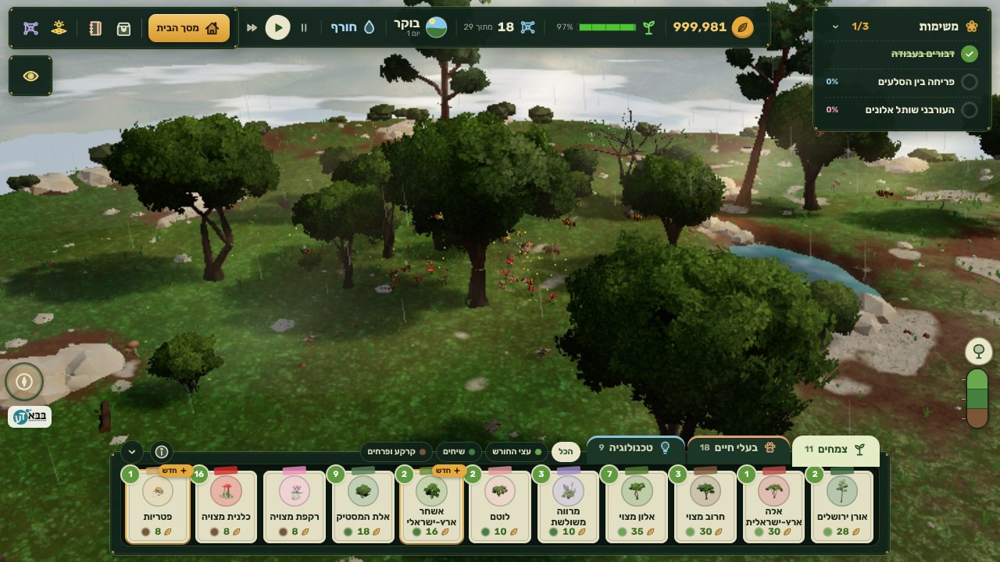
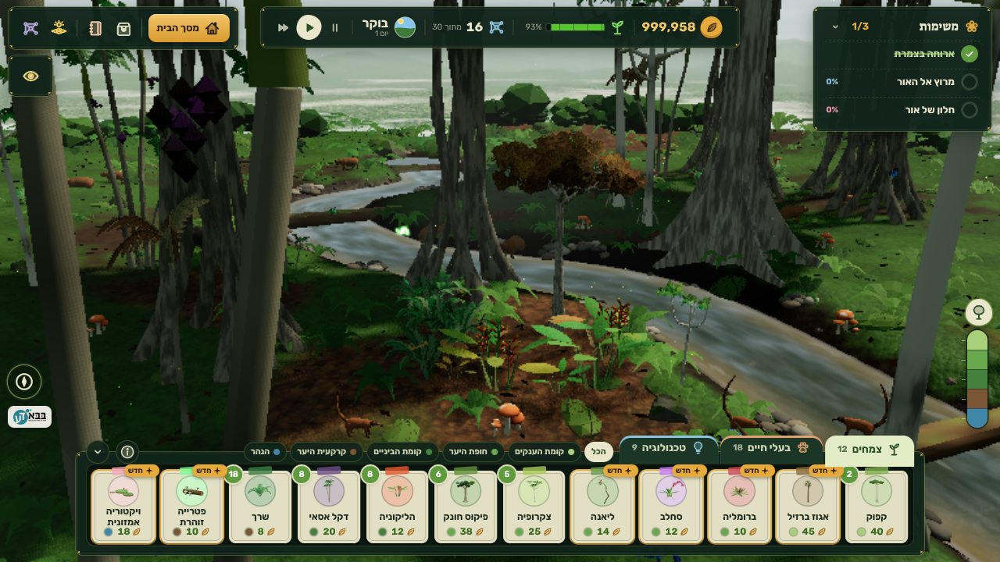
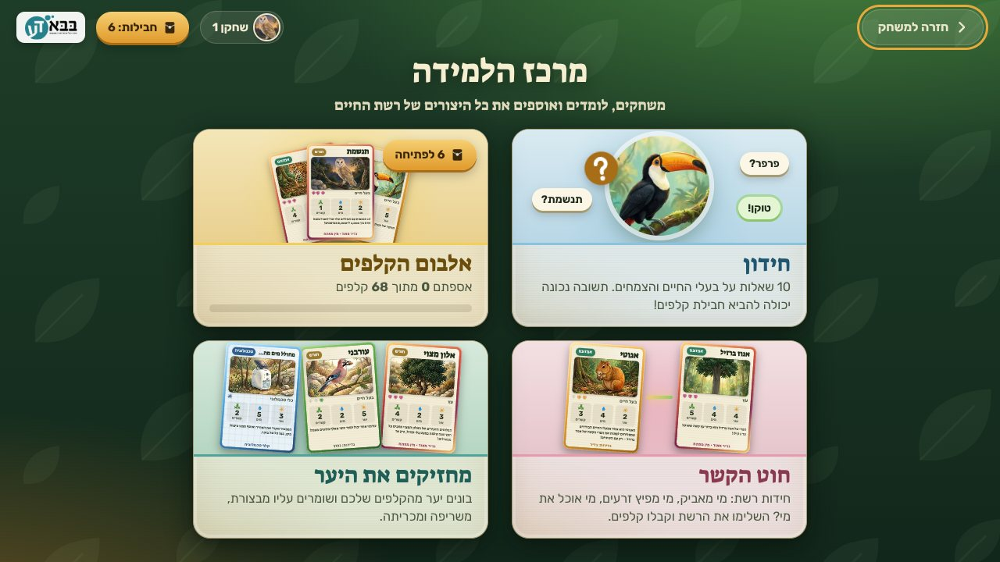
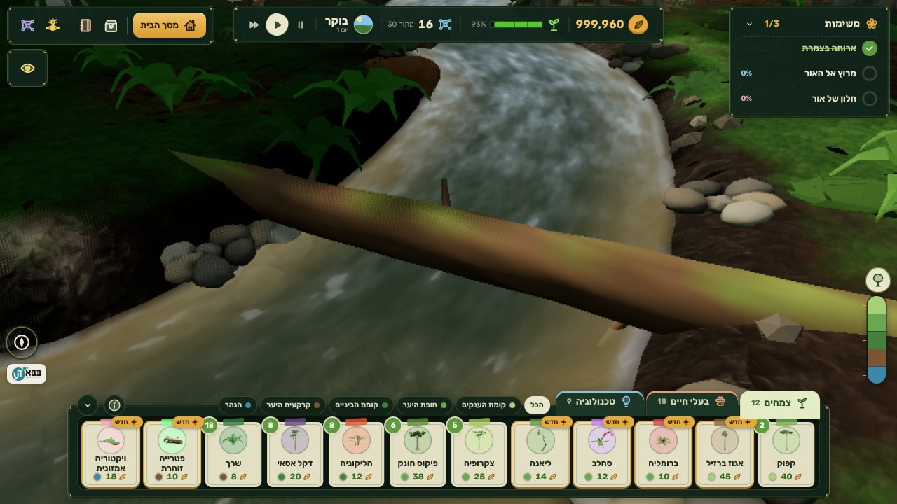

<div dir="rtl" align="right">

# רשת החיים

משחק תלת־ממד חינוכי על המגוון הביולוגי, לילדים בגילאי 6 עד 12. הילד בונה יער חי על אי קטן שמרחף בשמיים, שותל עצים ופרחים, מביא בעלי חיים, ומגלה מי צריך את מי: מי מאביק את מי, מי מפיץ זרעים של מי, מי אוכל מה ומי נותן בית למי. כל קשר כזה מופיע כחוט אור בין היצורים, ומכאן השם.

המשחק פותח עבור **בבא דע**, כחלק מהנושא השנתי "המגוון הביולוגי". הוא עובד בלי אינטרנט, כולו בעברית, ומתאים גם למחשבי בית ספר חלשים.



## הורדה

הגרסה האחרונה נמצאת בעמוד [Releases](https://github.com/avifly123-maker/reshet-hachaim/releases/latest). יש שם שלושה קבצים:

| קובץ | מה זה |
| --- | --- |
| `reshet-hachaim-setup-1.2.1.exe` | התקנה ל־Windows, המהדורה הכללית |
| `reshet-hachaim-torah-setup-1.2.1.exe` | התקנה ל־Windows, מהדורה עם מקורות מהתורה ומחז"ל על הטבע |
| `reshet-hachaim-mac-apple-silicon-1.2.1.zip` | למק עם שבב של אפל (M1 ומעלה), המהדורה הכללית |
| `reshet-hachaim-mac-intel-1.2.1.zip` | למק עם מעבד אינטל, המהדורה הכללית |
| `reshet-hachaim-torah-mac-apple-silicon-1.2.1.zip` | למק עם שבב של אפל, מהדורה עם מקורות |
| `reshet-hachaim-torah-mac-intel-1.2.1.zip` | למק עם מעבד אינטל, מהדורה עם מקורות |
| `reshet-hachaim-1.2.1.html` | המשחק כולו בקובץ אחד, נפתח בדפדפן Chrome או Edge בלי התקנה |

**התקנה ב־Windows:** מורידים את הקובץ ולוחצים עליו פעמיים. המשחק מותקן ונפתח לבד, ומופיע קיצור דרך על שולחן העבודה. הקובץ לא חתום דיגיטלית, ולכן Windows עלול להציג חלון כחול "Windows הגן על המחשב". לוחצים "מידע נוסף" ואז "הפעל בכל זאת". התקנה של גרסה חדשה נעשית מעל הקודמת, והשמירות נשארות.

**התקנה במק:** איזה קובץ? בתפריט התפוח, "אודות המק הזה": אם כתוב שם "שבב Apple M", מורידים את קובץ ה־apple-silicon; אם כתוב "מעבד Intel", את קובץ ה־intel. לוחצים פעמיים על הקובץ שירד, וגוררים את "רשת החיים" לתיקיית היישומים. בפתיחה הראשונה מק מציג הודעה שאינו יכול לאמת את המפתח, כי היישום לא נרשם אצל אפל. לוחצים "סיום", פותחים "הגדרות המערכת", נכנסים ל"פרטיות ואבטחה", גוללים למטה ולוחצים "פתח בכל זאת" ליד "רשת החיים". צריך לעשות את זה רק פעם אחת. (בגרסאות מק ישנות: קליק ימני על היישום, "פתח", ושוב "פתח".)

## מה יש במשחק

**שני אזורים.** יער הגשם של האמזונס, שבו הסיפור הוא המאבק על האור: עצי ענק מסתירים את השמש, וצמח קטן מחכה לפתח בחופה. והחורש הארץ־ישראלי, שבו הסיפור הוא העונות: גשמי חורף, פריחה באביב, יובש בקיץ. בכל אזור כ־30 מיני צמחים ובעלי חיים אמיתיים, ולכל אחד כרטיס עם עובדות שנבדקו מול מקורות ([רשימת המקורות](docs/sources.md)).

**שתי רמות.** "מתחילים" לקטנים: מעט מינים ומשימות קצרות. "מתקדמים": כל המינים, אירועי טבע (סערה, בצורת, שריפה, עץ ענק שנופל), וכלי טכנולוגיה שעוזרים לשמור על היער: רחפן ניטור, מצלמות שטח, רובוט הצלה, רחפן זריעה, תיבת קינון ועוד.

**מרכז הלמידה.** חידון, אלבום קלפים שאוספים מחבילות, "חוט הקשר" (חידות רשת: לחבר נכון בין היצורים), "מחזיקים את היער" (משחק קלפים שבו בונים יער שצריך לעמוד מול אירועי הטבע), ו"מי חזק ברשת?".

**ועוד:** מצלמות שטח שאפשר להיכנס לתוכן, סיור בעיני בעל חיים, דוח חוקר יומי שאפשר לשמור כ־PDF, פרופיל לכל ילד במחשב, ולילות עם קולות יער.

<table>
<tr>
<td></td>
<td></td>
</tr>
<tr>
<td></td>
<td></td>
</tr>
</table>

## איך זה נבנה

את המשחק פיתח **אבי פליישמן** (Avi Fleischman) יחד עם **Claude**, מודל הבינה המלאכותית של Anthropic. אבי קבע את החזון, את התוכן ואת כללי התוכן לקהל, את הכיוון העיצובי, ובדק כל גרסה. Claude כתב את הקוד, את סקריפטי הבלנדר שבנו את בעלי החיים, את הבדיקות האוטומטיות ואת כלי הבנייה, ובדק את המשחק בהרצה אוטומטית (צילומי מסך, משחק מדומה, סקירות קוד). כל העבודה נעשתה בשיחה, בעברית.

הסיפור המלא, שלב אחרי שלב, נמצא ב[יומן הפיתוח](docs/DEVLOG.md). השינויים בכל גרסה נמצאים ב־[CHANGELOG](CHANGELOG.md).

## זכויות

כל הזכויות שמורות. הקוד פתוח לקריאה וללמידה; שימוש, הפצה או שינוי של המשחק או של חלקים ממנו מחייבים אישור. לשאלות: דרך עמוד הפרויקט כאן בגיטהאב.

</div>

---

## For developers

**Reshet HaChaim** ("Web of Life") is an offline 3D ecosystem game in Hebrew. Plain JavaScript (ES modules) and [three.js](https://threejs.org) r186, bundled by [esbuild](https://esbuild.github.io) into a single self-contained HTML file, and wrapped in [Electron](https://www.electronjs.org) for Windows and macOS. No network at runtime: no CDN, no web fonts, no external images.

### Build

```bash
npm install
node build.mjs                      # → dist/index.html (single offline file, general edition)
node build.mjs --edition=torah      # → dist/index-torah.html
node build.mjs --desktop            # → desktop/app/ (core + per-zone packs, served as app://game/)
cd desktop && npm install && npx electron-builder --win nsis --x64                              # general installer
npx electron-builder --mac                  # Mac: release/mac-arm64/*.app and release/mac/*.app (Intel)
rcodesign sign release/mac-arm64/reshet-hachaim.app     # ad-hoc signature (apple-codesign; required on Apple Silicon)
python3 ../tools/zip-mac-app.py release/mac-arm64/reshet-hachaim.app out.zip "רשת החיים.app"   # zip that keeps symlinks
node ../build.mjs --desktop --edition=torah && npx electron-builder --config builder-torah.json --win nsis --x64
```

Build the torah desktop app first and the general one last: both write to `desktop/app`.

### Checks

```bash
node tools/validate-content.mjs     # species data, missions, events, and the content rules on every on-screen string
node tools/validate-kids.mjs        # the beginners' mode
python3 tools/play.py dist/index.html <script.json> 800 460   # headless run (Playwright + Chromium): wait / js / shot steps
python3 tools/check-old-saves.py desktop/app                  # saves from 1.0.0 still load
```

### Layout

| Path | What |
| --- | --- |
| `src/main.js` | boot, start screen, zone loading, automatic quality tiers |
| `src/game/` | the game loop, missions, events, tools, explorer report |
| `src/sim/`, `src/world/` | species registry, light model, plant and animal entities and their behaviour |
| `src/env/` | island, terrain, water, sky, weather, river logs, render pipeline |
| `src/models/` | procedural plants and trees, the Blender-rigged animal loader (`rigged.js`) |
| `src/learn/` | the learning hub and its card games |
| `src/audio/audio.js` | all sound, synthesised with Web Audio (no recordings) |
| `src/data/` | species content (`amazon.js`, `grove.js`, `kids.js`, `torah.js`) and generated asset modules |
| `art/` | source assets: Blender renders and exports, card paintings, panoramas |
| `tools/blender/` | Blender Python: `animal_kit.py` and one spec per animal (31 rigged, animated animals), panoramas, ground textures |
| `tools/build-*.py` | pack `art/` into the `src/data/*.js` modules |
| `desktop/` | Electron shell (`main.js`, `preload.js`, PDF export) and installer configs |
| `CONTRACT.md` | the architecture and module contract |

The animals are built in Blender from Python specs: a voxel-remeshed body of blended shapes, per-vertex colours, an armature with automatic weights, and baked action clips (idle, walk, run, eat, sleep, fly, climb, hang…). `tools/build-rigged.py` packs them into compact base64 modules that `src/models/rigged.js` turns into three.js skinned meshes.

### Content rules

The audience is Haredi children: no human figures, no women or girls depicted, no dinosaurs or "millions of years", simple and gentle Hebrew, fully right-to-left. `tools/validate-content.mjs` enforces the text rules.

### License

All rights reserved. The source is published for reading and learning; any other use needs permission.
