# דרישות לגיפים של רשת החיים (סט 11)

המסמך הזה מיועד לכלי שיוצר את הגיפים. כל תמונות הדוגמה נמצאות בתיקייה `art/gif-refs/` בפרויקט, והן מוצגות גם כאן ליד כל גיף. בכל גיף שמופיעה בו דמות שלנו, מעלים לכלי את תמונת הדוגמה שלה.

## דרישות שחלות על כל גיף

**איכות**
- גבוהה יותר ממה שנשלח עד עכשיו.
- לפחות 16 תמונות בגיף. עדיף 24.
- תנועה רכה ואיטית: מצלמה שזזה לאט, עלים בתנועה, מים זורמים, אור שמשתנה.
- לא קפיצות בין תמונות שונות.
- לולאה חלקה: התמונה האחרונה מתחברת לראשונה.
- אורך: 3 עד 5 שניות.

**גודל**
- מסכי טעינה: רחב, 1280 על 720.
- חבילת הקלפים: מרובע, 1024 על 1024.
- אם הכלי יכול להוציא סרטון MP4 או WebM, זה עדיף על גיף. אני ממיר בעצמי.

**סגנון**
- איור תלת־ממדי רך וחם, כמו סרט אנימציה איכותי לילדים.
- צבעוני, אבל לא "קרקס".
- אור טבעי, עומק, פרטים יפים.
- האיים מרחפים באוויר כמו בתמונות הדוגמה `island-*.png`.

**אסור בשום גיף**
- **בני אדם**, גם לא דמות קטנה ברקע. גם לא ידיים.
- **צלבים** מכל סוג:
  - תורן עם קורה בספינה.
  - חלון עם מוטות שנפגשים כמו פלוס.
  - סימן פלוס, כוונת, או עמוד חשמל עם זרוע.
  - ספינה טבועה רק בלי תורנים, או בלי ספינה בכלל.
- **חזירים.**
- **דינוזאורים.**
- **דמויות מסרטים או מסדרות**, וגם לא משהו שדומה להן. למשל דגי שונית שנראים כמו נמו ודורי, או קקטוס עם פנים.
- **טקסט, אותיות ומספרים** בתוך התמונה. את הכתובות אנחנו מוסיפים במשחק.

**הדמויות שלנו**
- קוּבִּי, ניצוץ ורובו־דע צריכים להיראות בדיוק כמו בתמונות הדוגמה: אותה צורה, אותם צבעים, אותו גוף.
- לא להמציא להם גרסה אחרת. ילד ששיחק במשחק יזהה הבדל.

---

## 1. פתיחת חבילת קלפים

תמונת דוגמה: הגיף הקודם של החבילה, רק באיכות גבוהה יותר.

**פרומפט:** חבילת קלפים מבריקה בצבע ירוק כהה עם שוליים מוזהבים, עומדת על שולחן עץ ביער ירוק מטושטש. על החבילה ציור של שלושה קלפים: צפרדע כחולה, טוקן וצבי. החבילה נושמת קלות, ניצוץ אור עובר על הזהב משמאל לימין, והקצה העליון נקרע לאט ויוצא ממנו אור זהוב רך. בלי אותיות על החבילה, את השם נוסיף במשחק. מרובע, 1024 על 1024.

## 2. מסך טעינה: יער הגשם של האמזונס

תמונת דוגמה: `island-amazon.png`

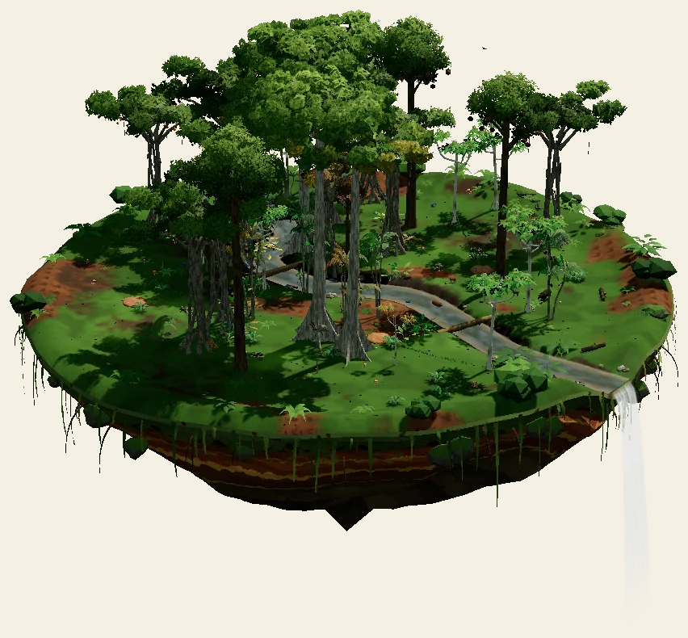

**פרומפט:** אי מרחף של יער גשם עבות מעל ים עננים. עצים ענקיים עם ליאנות, מפל קטן שנשפך מקצה האי אל העננים, נהר תכלת מתפתל. טוקן על ענף מנקה נוצה, פרפר מורפו כחול עף לאט. ערפל עדין זז בין הצמרות, קרני שמש נכנסות בין העלים. המצלמה מתקרבת לאט מאוד. רחב, 1280 על 720.

## 3. מסך טעינה: החורש הארץ־ישראלי

תמונת דוגמה: `island-grove.png`

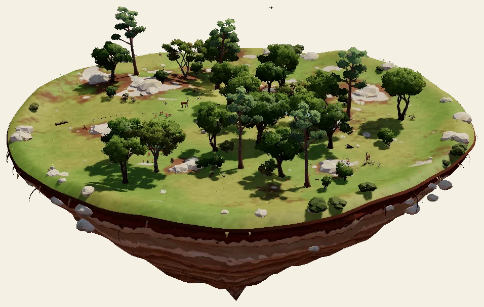

**פרומפט:** אי מרחף של חורש ים־תיכוני באביב: אלונים ואלות, סלעי גיר, כלניות אדומות ורקפות בין הסלעים. דוכיפת עומדת על סלע ומרימה ציצה, צבי ארץ־ישראלי מציץ מבין השיחים. רוח קלה מניעה עשב ופרחים, אור אחר הצהריים חם וזהוב. רחב, 1280 על 720.

## 4. מסך טעינה: השונית של אילת

תמונת דוגמה: `island-reef.png`

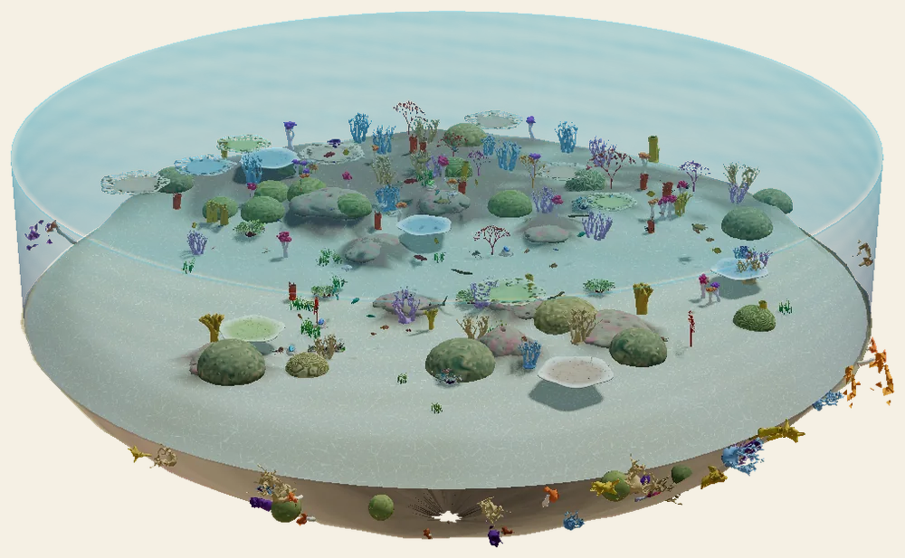

**פרומפט:** מתחת למים בשונית אלמוגים במפרץ אילת. אלמוגי שיח, אלמוגי מוח ומניפות ים בצבעים טבעיים. להקת דגים קטנים כסופים זזה יחד, צב ים ירוק שוחה לאט, שושנון בין זרועות שושנת ים. קרני אור יורדות מפני המים ומרצדות על החול. בלי ספינה ובלי דגים שנראים כמו דמויות מסרט. רחב, 1280 על 720.

## 5. מסך טעינה: המדבר

תמונת דוגמה: `island-desert.png`

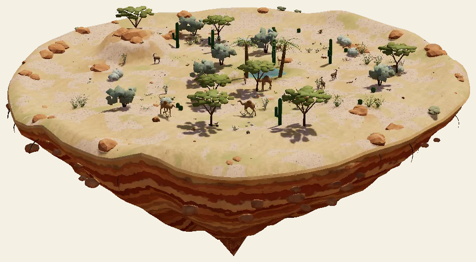

**פרומפט:** אי מרחף של מדבר הנגב: דיונות זהובות, סלעי אבן חול, שיטה סלילנית, שני דקלי תמר ליד נחל יבש. שועל פנק עם אוזניים גדולות נח בפתח מחילה, יעל נובי עומד על סלע גבוה. חול דק עף ברוח מעל הדיונות, אור שקיעה כתום. בלי קקטוסים עם פנים. רחב, 1280 על 720.

## 6. מסך טעינה: הסוואנה

תמונת דוגמה: `island-savanna.png`

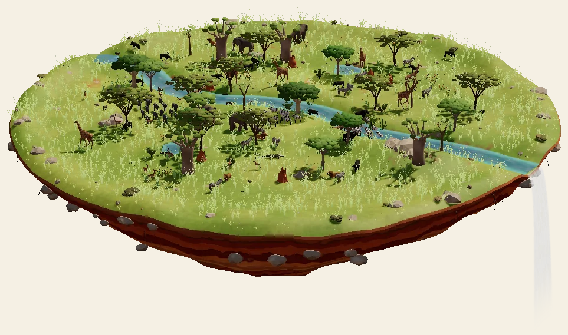

**פרומפט:** אי מרחף של סוואנה אפריקאית בעונת הגשמים: עשב גבוה ירוק־זהוב, שיטה סוככנית שטוחה, באובב עבה, תל טרמיטים אדום. ג׳ירפה אוכלת מראש השיטה, זברות רועות בעשב, פיל שותה מבור מים. עשב מתנופף ברוח, ענן גשם רחוק. בלי טריפה ובלי דם. רחב, 1280 על 720.

## 7. מסך טעינה: המעבדה של רובו־דע

תמונות דוגמה: `robo-da.png` (הדמות) ו־`lab-room.png` (החדר)

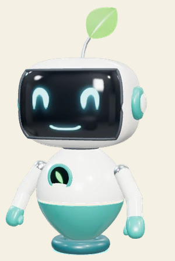 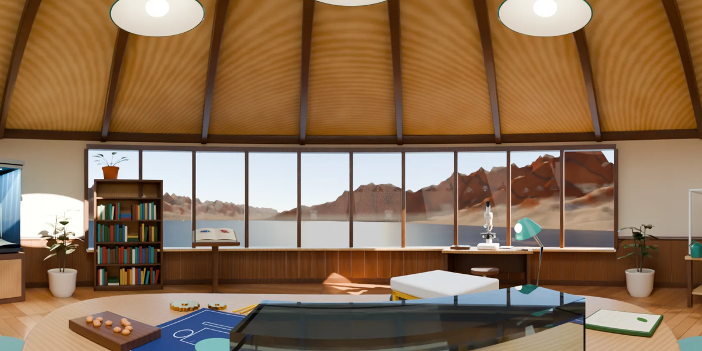

**פרומפט:** חדר מעבדה עגול עם תקרת עץ, חלונות רחבים שפונים למפרץ אילת ולהרי אדום. רובו־דע (בדיוק כמו בתמונה: ראש לבן עם מסך שחור ועיניים טורקיז, עלה ירוק קטן על הראש, גוף לבן־טורקיז, ידיים טורקיז) מרחף ליד מיקרוסקופ, מסתכל, ומחייך. אקווריום עם אלמוגים בצד, מים מרצדים, אבק זהוב באור. החלונות בלי מוטות שנפגשים כמו פלוס. רחב, 1280 על 720.

## 8. מסך טעינה: מעבדת הרובוטים

תמונות דוגמה: `kubi.png` (הדמות) ו־`robot-workshop.png` (המקום והרובוטים)

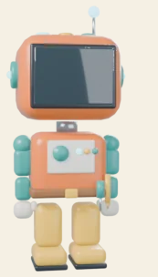 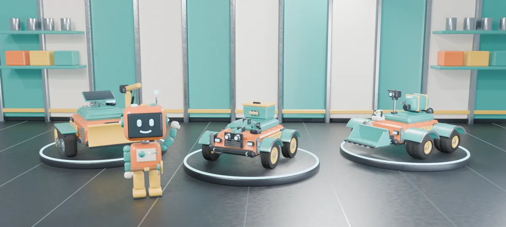

**פרומפט:** קוּבִּי (בדיוק כמו בתמונה: ראש כתום עם מסך כהה, גוף כתום עם פסים טורקיז, רגליים בצבע חול) עומד על משטח בשדה ירוק, ולידו שני רובוטים כתומים־טורקיז מהתמונה. קוּבִּי מצביע, ורובוט אחד נוסע קדימה ושותל זרע בגומה. רחפן עם שלושה מדחפים (לא ארבעה) מרחף מעל. בלי חלקי פאזל עם צורות של פלוס. רחב, 1280 על 720.

## 9. מסך טעינה: הסדנה של ניצוץ

תמונות דוגמה:
- `nitzotz-face.png`: ניצוץ עצמו. נורה שקופה עם חוט להט זהוב, עיניים כחולות גדולות, בסיס כסוף מוברג, שתי כפפות לבנות שמרחפות לידו. בלי כתר ובלי גלגלי שיניים עליו.
- `workshop-room.png` ו־`workshop-room-wide.png`: החדר.

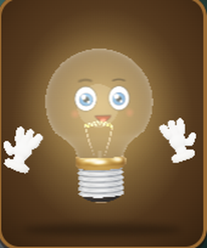 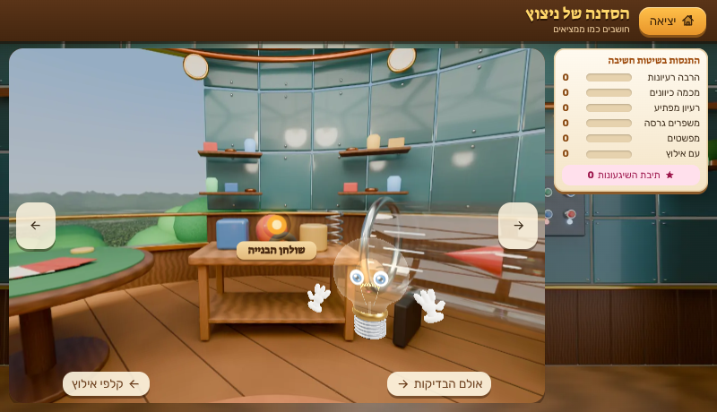 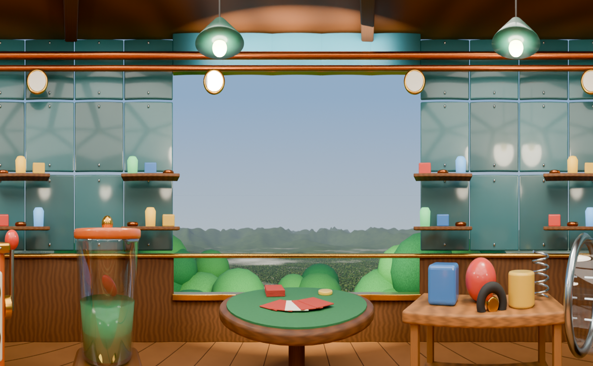

**פרומפט:** סדנת ממציאים עגולה גבוה בין צמרות יער הגשם. קירות פח טורקיז עם מסמרות, צינורות נחושת, מדפים עם צנצנות שזוהרות קלות, ומכונת רעיונות כתומה עם חלון עגול. ניצוץ מרחף באמצע, האור שלו מתחזק פתאום כשעולה לו רעיון, הכפפות שלו מתרוממות בהתלהבות וניצוצות קטנים נופלים ממנו. מהחלון רואים את צמרות היער ועננים. רחב, 1280 על 720.

## 10. אירועי השבוע (ארבעה קטנים)

כל אחד מרובע, 1024 על 1024, 3 שניות.

- **הצנצנת:** צנצנת זכוכית סגורה עם עולם קטן בפנים (אדמה, טחב, שתיל), טיפות לחות על הזכוכית, אור בוקר.
- **הבלש של השבוע:** לוח שעם עם רמזים מצוירים (עקבות, נוצה, תמונה של מחילה) מחוברים בחוטים אדומים, זכוכית מגדלת זזה על הלוח. בלי אותיות.
- **מירוץ הרובוטים:** מסלול קצר באי, שער עם קשת, רובוט כתום נוסע וכתם אור טורקיז שקוף אחריו.
- **התקלה:** מכונה קטנה בסדנה שמעשנת מעט ונעצרת, נורה אדומה מהבהבת, ואז חוזרת לעבוד.

---

## איך מוסרים

- שמות קבצים: `pack`, `amazon`, `grove`, `reef`, `desert`, `savanna`, `lab`, `robolab`, `workshop`, `week-jar`, `week-detective`, `week-race`, `week-glitch`.
- הסיומת לפי מה שהכלי יוצא: `.gif`, `.mp4` או `.webm`.
- אני בודק כל אחד לפני שהוא נכנס: שאין צלב, שאין דמות זרה, ושהדמויות שלנו נכונות.
